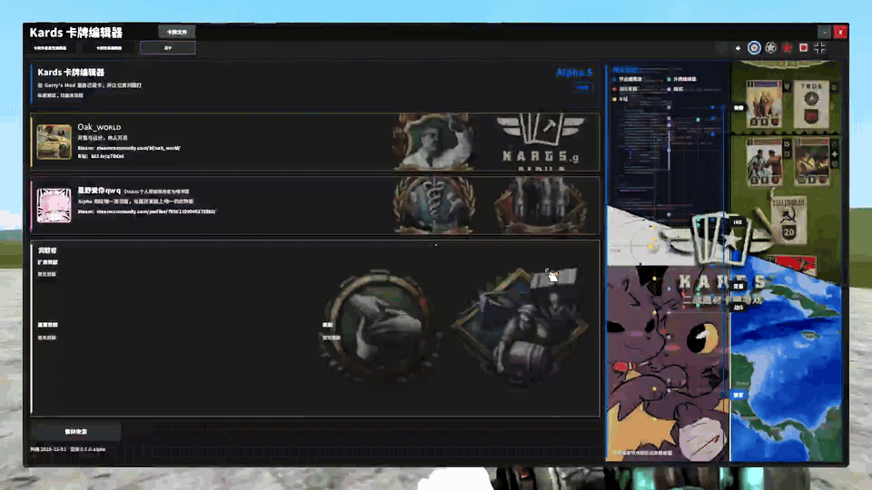
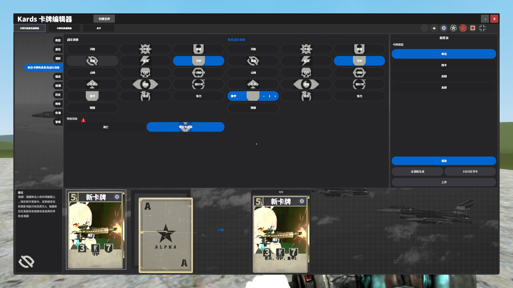
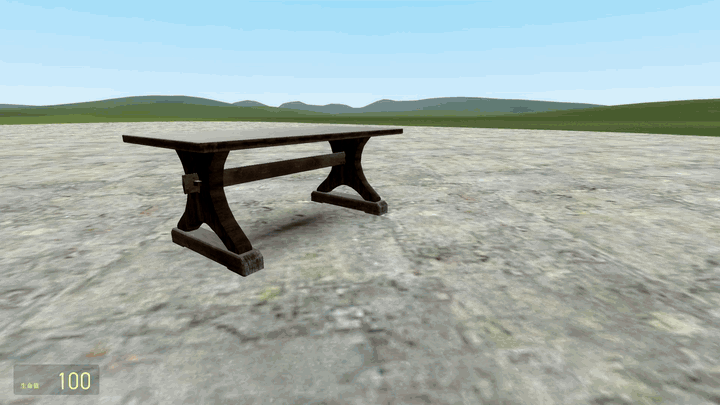
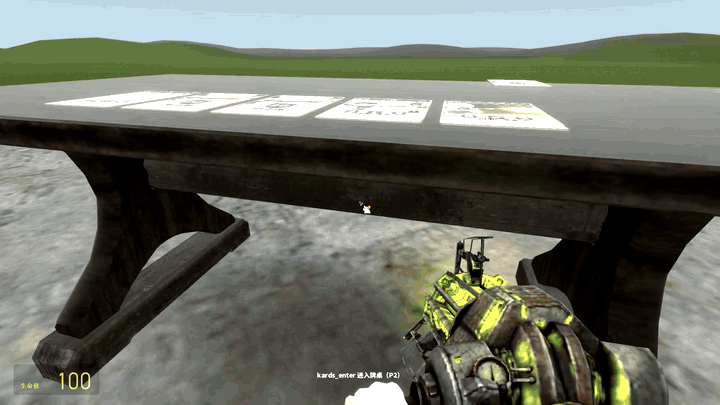
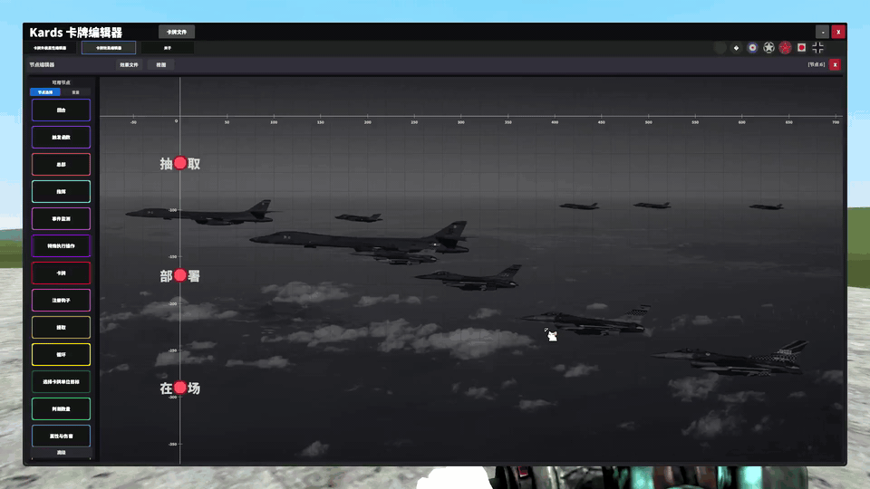
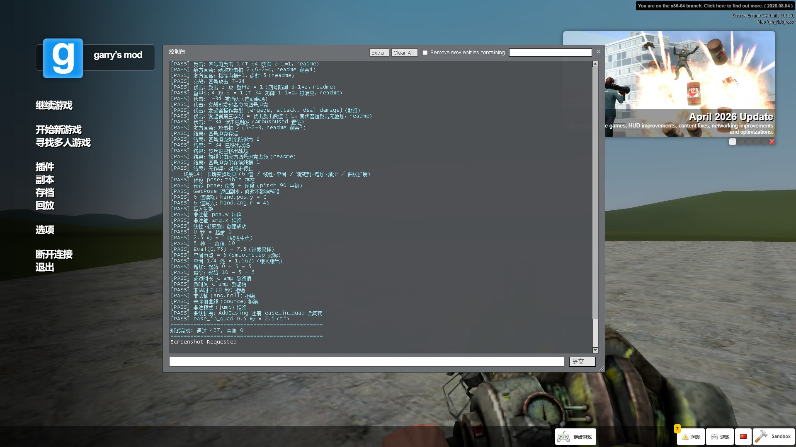

# Kards .g

## Alpha 5 版本

Kards .g 把二战题材卡牌游戏 KARDS 的玩法搬进 Garry's Mod。
KARDS 以创新的“前线”区分支援线与战区。玩家需消耗指挥点部署单位与打出指令，激活反制

版本 Alpha 5：造卡达到 Beta 要求。组卡达到 Alpha 要求。

> [!WARNING]
> 当前战斗系统仍然处于早期阶段，尚未达到 Alpha 要求，极不稳定且体验差。因此造成了造卡目前暂时成为了本插件的主要玩法。

## 动机

*如果能在 Gmod 里打 Kards 会怎么样？*

按照这个想法，做出了 Kards .g 这一项目。虽然我的根本目的是能看到在 Gmod 里打 Kards 的场景，但却意外解决了一个 Kards 社区问题：diy（自定义卡牌）卡牌不能实战的问题。

  

## 为什么是游戏模式

Kards 本身已是完整玩法，值得作为一个独立的游戏模式存在。

更实际的原因是开服。进入 GMod 须选择一个游戏模式，想让玩家按 Kards 的规则对局，服务器就应该处于 Kards 游戏模式。

游戏模式也让玩法更容易被找到。服务器出现在查看多人游戏列表里时，玩家能看到 Kards 标识。

Kards 的玩法并不强制依赖游戏模式。造卡、组卡与牌桌对局在 Sandbox 等模式下同样工作，游戏模式把同一玩法改为可开服形态。

> [!CAUTION]
> Kards .g 只有版本号带有 Server 段时才能被正常地用于开服。当前 Kards .g 关于服务器玩法部分（上传与审查卡牌、权限）仍然在开发，**未达到 Alpha 标准**且处于低优先级。如果您确实使用 Kards .g 作为您的服务器玩法，务必联系我！

## 前置与安装

本插件以 [SourceHan San Heavy](https://steamcommunity.com/sharedfiles/filedetails/?id=3685293796) ，[简单静态模型导入器](https://steamcommunity.com/workshop/filedetails/?id=3706539692) 和 [StarfallEx](https://github.com/thegrb93/StarfallEx) 作为前置。在你克隆本仓库或订阅时，务必确保前置已安装。

从 [Steam](https://steamcommunity.com/sharedfiles/filedetails/?id=3720439560)的创意工坊订阅本插件，或将本仓库克隆至`D:\…\garrysmod\addons`内则安装成功。

> [!CAUTION]
> 本仓库设立目的为提供注释版本的项目，因此未将`\sounds`写入仓库，这个举措很大缩减了仓库的体积，但会导致大量 lua 错误（`sound_PlayFile`等所指向的音频不存在）。如果您仅是要游玩Kards.g，务必选择Steam创意工坊订阅！

> [!WARNING]
> 当前项目无任何默认卡牌存档，这意味着你须造卡（至少3张普通品质卡和一张限定品质卡）并组成卡组后方能应用于战斗或等待开发补全默认卡牌。

## 操作

### 造卡

在 C 键菜单点击卡牌编辑器图标，或往控制台输入 `kards_editor` 打开自定义卡牌编辑器。

### 卡牌外貌属性编辑器

在每个书签页配置完成你的卡牌。注意有一部分设置还不稳定或者没作用。

> [!NOTE]
> **预报**尚未开发完成

总控台的上传目前没有作用，是未来服务器内容。在计划中，user 等级的玩家上传卡牌后，需要 admin 管理员审核，然后才加入服务器可用牌库，并可以给所有人用于组卡。

### 卡牌效果编辑器

给卡牌卡面写好效果后，还需配置节点。

战斗时，会从开始点发出信号，信号通过连接线传输，信号传输到的节点触发操作。

总控台点击“生成3D2D卡牌”，生成一个填充了动态纹理的卡牌物理模型`data_static\pmx_static_importer\models\basic_card`。

## 战斗

以一个牌桌`data_static\pmx_static_importer\models\wooden_table`实体为战斗系统核心。在牌桌<u>长边</u>执行`kards_enter`进入牌桌

任何人都能看到战斗

#### 匹配

进入牌桌即开始匹配，等待其他对手加入牌桌另一侧。两侧均有玩家、各自有 40 张卡组，且都准备后，对局开始。将对方总部摧毁以获胜。

#### 战斗时手牌

> [!NOTE]
> 根据 Kards 手牌分布反向推导的手牌分布算法，不一定是 Kards 用的算法

让手牌沿圆弧分布，底部均指向圆心。

设手牌数为 $N$，第 $i$ 张的对称偏移 $k=\frac{N+1}{2}-i$，则

$$
x_i=k\cdot s,\qquad y_i=R-\sqrt{R^2-x_i^2}
$$

每张卡再绕卡面法线旋转，角度按序号线性分摊：

$$
\psi_i=\frac{k}{m}\cdot\alpha,\qquad m=\frac{N-1}{2}
$$

其中 $s=2$, $R=50$, $\alpha=30^\circ$。任意 $N$ 都成立，无需分类讨论奇偶性。

完整推导见 [手牌分布的原理](docs/手牌分布的原理.md)。

### 组卡

在牌桌<u>宽边</u>执行`kards_enter`使牌桌进入组卡模式，到牌桌正面再次执行，开始组卡。单击卡牌将卡加入卡组。当卡组达到40张卡时，满足保存卡组条件。

任何人都能看到任意玩家组卡

### INE：2D 节点编辑器

INE 是 Gmod 罕见的 2D 节点编辑器

Kards .g 使用 INE 技术表达卡牌效果，使用于卡牌效果编辑器

当前 Kards .g 对 INE 使用情况

- 15 类节点：执行、条件、循环、事件、注册钩子、回合、抽取、目标选择等
- 事件钩：回合开始、结束、部署、打出指令、反制

执行线与数据线分离，支持循环第二出口与变量引用是 INE 的特点。

详见 [docs/INE.md](docs/INE.md)

目前任何人都能打开编辑器

## 控制台命令

下面的命令需要在 Garry's mod 游戏内的控制台输入。

### 玩家命令

#### `kards_editor`

- 语法：`kards_editor`
- 端：客户端注册，本地开关编辑器；服务端另有同名入口
- 作用：打开或关闭卡牌画布编辑器。客户端走 `ToggleEditor`，编辑器已开则关闭，未开则打开；服务端入口调用 `OpenEditor(ply)`，供服务器控制台或其他代码使用。
- 位置：`lua/autorun/sh_card_editor_loader.lua:450`（客户端）、`:467`（服务端）

#### `kards_enter`

- 语法：`kards_enter`
- 端：客户端
- 作用：按玩家所处位置决定行为。已进入牌桌则请求退出；紧贴在牌桌长边则请求进入；紧贴在牌桌宽边则请求在组卡与对战模式之间切换。进入与切换由服务端做位置与槽位校验。
- 建议设为快捷键指令
- 示例：`bind R kards_enter`
- 位置：`lua/entities/sent_kards_battle_table/cl_init.lua:683`

#### `kards_view`

- 语法：`kards_view [p1|p2]`
- 端：客户端
- 作用：切换距离玩家最近一张牌桌的视角，不需要进入牌桌。
  - 空：观战者视角，卡牌朝向按归属方
  - `p1`：P1 俯视视角，画面上朝 P1 侧
  - `p2`：P2 俯视视角，画面上朝 P2 侧
- 位置：`lua/entities/sent_kards_battle_table/cl_init.lua:716`

#### `kards_table_bgm`

- 语法：`kards_table_bgm [kards|wards]`
- 端：客户端
- 作用：固定或切换战斗 BGM 风格。
  - 带参数：固定为指定风格，对局中正在播放会立即按新风格重播
  - 留空：在两个风格之间切换
  - 抉择：kards,wards
- 只影响本机播放
- 示例：`kards_table_bgm wards`
- 位置：`lua/entities/sent_kards_battle_table/cl_battle_bgm.lua:165`

#### `kards_toggle_appearance`

- 语法：`kards_toggle_appearance`
- 端：客户端
- 作用：切换卡牌外貌编辑器的激活状态，仅在画布编辑器已打开时生效。激活时关闭屏幕点击器，退出时恢复。
- 位置：`lua/card_editor/canvas_editor/appearance_editor/cl_appearance_editor.lua:1213`

对战测试与开发调试（operator 及以上，点击展开）

### 对战测试

以下命令要求 operator 及以上权限，判定见 `KARDS.IsOperator`。

#### `kards_forcestart`

- 语法：`kards_forcestart`
- 端：服务端
- 执行者必须已在牌桌内
-  
- 作用：跳过双方就绪与 3 秒倒计时，直接开始正式对局。用于单人快速测试。
- 位置：`lua/entities/sent_kards_battle_table/table_session.lua:346`

#### `kards_switch`

- 语法：`kards_switch`
- 端：服务端
- 执行者必须已在牌桌内且对局已开始
- 作用：无对手模式下把玩家本体移到对面槽位，同时互换卡组归属。离开的槽转为虚拟对手，到达的槽转为真实玩家。接管伪用户期间失效。
- 位置：`lua/entities/sent_kards_battle_table/table_session.lua:374`

#### `kards_fakeuser`

**注意：未经内部测试的命令**

- 语法：`kards_fakeuser [0|1]`
- 端：服务端
- 作用：无对手测试中把虚拟对手接管为伪用户，之后可用下列命令替对手出牌与结束回合。
  - 无参数或 `1`：启动接管
  - `0`：关闭接管，恢复 `kards_switch` 与回合超时
- 位置：`lua/entities/sent_kards_battle_table/sv_fakeuser.lua:617`

#### `kards_fakeuser_hand`

**注意：未经内部测试的命令**

- 语法：`kards_fakeuser_hand`
- 端：服务端
- 作用：列出对方手牌，含序数、名称、花费、反制激活状态、属性、词条与效果。

#### `kards_fakeuser_play`

**注意：未经内部测试的命令**

- 语法：`kards_fakeuser_play <手牌序数>`
- 端：服务端
- 作用：选定并打出对方一张手牌。指挥点不足会拒绝；单位为缓存待部署，指令立即打出；开发三选一与指向选择会挂起，等待 `kards_fakeuser_x` 续选；反制只切换激活状态。
- 示例：`kards_fakeuser_play 3`

#### `kards_fakeuser_x`

**注意：未经内部测试的命令**

- 语法：`kards_fakeuser_x <数字>`
- 端：服务端
- 作用：为上一次 `kards_fakeuser_play` 挂起的操作提交选择。
  - 单位部署：槽位 `1..5`
  - 开发候选：`1..3`
  - 指向选择：两位编码，友方阵线 `11..15`，前线 `1..5`，敌方阵线 `-1..-5` 或 `-11..-15`
- 示例：`kards_fakeuser_x 12`

#### `kards_fakeuser_endturn`

**注意：未经内部测试的命令**

- 语法：`kards_fakeuser_endturn`
- 端：服务端
- 作用：结束对方回合。仍有卡牌等待续选或未轮到对方时拒绝。

#### `x`

**注意：未经内部测试的命令**。这是全局短名，与其他模组撞名可能性较高。

- 语法：`x <数字>`
- 端：服务端
- 作用：`kards_fakeuser_x` 的短命令，仅在有待续选操作时生效，其余情况提示“当前没有等待续选的操作”。
- 位置：`lua/entities/sent_kards_battle_table/sv_fakeuser.lua:627`

### 开发与调试

#### `kards_camera`

- 语法：
  - `kards_camera`
  - `kards_camera reset`
  - `kards_camera table`
  - `kards_camera front`
  - `kards_camera <x> <y> <z> <pitch> <yaw> [fov]`
- 端：客户端
- 只影响本机
- 作用：接管或恢复牌桌相机。留空打印当前状态；`reset` 停止动画并恢复默认相机；`table` 与 `front` 为预设视角；五个数值为相对牌桌的世界坐标与角度，可选 fov。
- 位置：`lua/kards/cl_battle_camera.lua:184`

#### `kards_battle_list`

- 语法：`kards_battle_list`
- 端：服务端
- 权限：operator 及以上，服务器控制台放行
- 作用：列出已导入的静态模型，输出 model\_id 与显示名，供 `kards_battle_table` 的第二个参数使用。
- 位置：`lua/kards/sh_battle_render.lua:671`

#### `kards_battle_table`

**已弃用的命令**

- 语法：`kards_battle_table [scale] [modelID]`
- 端：服务端
- 权限：operator 及以上，服务器控制台放行
- 作用：在原点生成一张测试牌桌。scale 缺省 0.5，modelID 缺省时自动选择。
- 示例：`kards_battle_table 0.5`
- 位置：`lua/kards/sh_battle_render.lua:676`

#### `kards_battle_clear`

- 语法：`kards_battle_clear`
- 端：服务端
- 权限：operator 及以上，服务器控制台放行
- 作用：移除全部同 TableID 的牌桌与卡牌实体，并恢复动画的真实时间开关。会清掉正在进行的测试，不要在有人使用牌桌时执行。
- 位置：`lua/kards/sh_battle_render.lua:688`

#### `kards_battle_demo`

**已弃用的命令**

- 语法：`kards_battle_demo [cardScale] [tableScale]`
- 端：服务端
- 权限：operator 及以上，服务器控制台放行
- 作用：一键演示，生成牌桌与 6 张卡，依次发牌、放置一张、移除一张，并联动相机预设。
- 位置：`lua/kards/sh_battle_render.lua:694`

#### `kards_anim_diag`

**说明：本项目已停用待机动画，因此指令等同于无效**

- 语法：`kards_anim_diag`
- 端：客户端
- 作用：打印动画诊断，包括本地玩家是否有效、WOS 是否挂载、当前模型、`editor_idle` 序列是否存在。
- 位置：`lua/card_editor/cl_animation.lua:139`

#### `kards_start_editor_anim`

**说明：本项目已停用待机动画，因此指令无效**

- 语法：`kards_start_editor_anim`
- 端：服务端
- 作用：让执行玩家播放编辑器待机动画。编辑器打开时由客户端自动调用，属正常玩法流程，因此不设权限限制。
- 位置：`lua/card_editor/sv_animation.lua:84`

#### `kards_stop_editor_anim`

**说明：本项目已停用待机动画，因此指令无效**

- 语法：`kards_stop_editor_anim`
- 端：服务端
- 作用：停止编辑器待机动画。编辑器关闭时由客户端自动调用，原因同上。
- 位置：`lua/card_editor/sv_animation.lua:91`

#### `kards_close_editor_keep_anim`

**说明：本项目已停用待机动画，因此指令仅关闭编辑器界面**

- 语法：`kards_close_editor_keep_anim`
- 端：服务端
- 权限：operator 及以上，服务器控制台放行
- 作用：关闭编辑器界面但保留待机动画，用于测试动画衔接。
- 位置：`lua/card_editor/sv_animation.lua:100`

#### `kards_test_notification`

- 语法：`kards_test_notification <提示内容文本> [r] [g] [b]`
- 端：客户端
- 作用：在编辑器内弹出一条测试提示，默认深灰色，可指定 RGB。
- 示例：`kards_test_notification 测试 255 0 0`
- 位置：`lua/card_editor/canvas_editor/effect_editor/cl_canvas_editor.lua:1892`

#### `kards_reload_templates`

**提示：每次更改节点模板 DSL 后，执行此命令即可立刻看到修改后节点列表**

- 语法：`kards_reload_templates`
- 端：客户端
- 作用：重新读取 `data_static/kards/node_templates/` 与本地副本中的节点模板，改模板后无需重启游戏。会顺带加载规则词汇表模块。
- 位置：`lua/card_editor/ine_editor/cl_ine_variable_dialogs.lua:1050`

#### `kards_test`

**说明：使用 test 系指令可快速测试节点解析到战斗，战斗操作效果是否达到预期**

- 语法：`kards_test`
- 端：仅服务端注册
- 权限：operator 及以上，服务器控制台放行
- 作用：运行战斗骨架测试，覆盖刻度格式、爆牌、钩子反制、战场布局、卡组与士气等场景，使用 MockCard，不依赖真实牌桌。结束时输出通过与失败数。
- 位置：`lua/kards/test/ticklog_test.lua:1830`

#### `kards_node_test`

- 语法：`kards_node_test`
- 端：仅服务端注册
- 权限：operator 及以上，服务器控制台放行
- 作用：运行节点解析器测试，按节点类型分割场景，验证解析与操作。
- 位置：`lua/kards/test/node_parser_test.lua:967`

#### `kards_node_battle_test`

- 语法：`kards_node_battle_test`
- 端：仅服务端注册
- 权限：operator 及以上，服务器控制台放行
- 作用：运行节点效果的战斗场景测试，对 action 与 card 的组合建立战斗场景，由 P1 打出带 effect 的指令卡触发节点效果。
- 位置：`lua/kards/test/node_parser_battle_test.lua:3113`

## 文档

[INE：独立节点编辑器](docs/INE.md)

[手牌分布的原理](docs/手牌分布的原理.md)

[CONTRIBUTING](docs/CONTRIBUTING.md)

## 来源

见游戏内关于页的素材来源。

***

本插件为非官方作品。

音乐扩展以及未来的扩展模组计划由其他扩展模组提供。见 [CONTRIBUTING](docs/CONTRIBUTING.md)。

- `lua/` 下的源码采用 MPL-2.0 协议，全文见 [LICENSE](LICENSE)。
- `materials/` `sounds/`不在 MPL-2.0 范围内。

